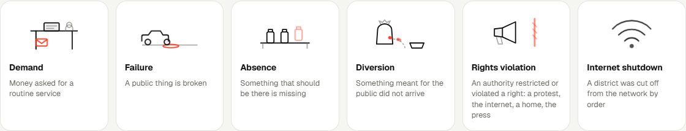
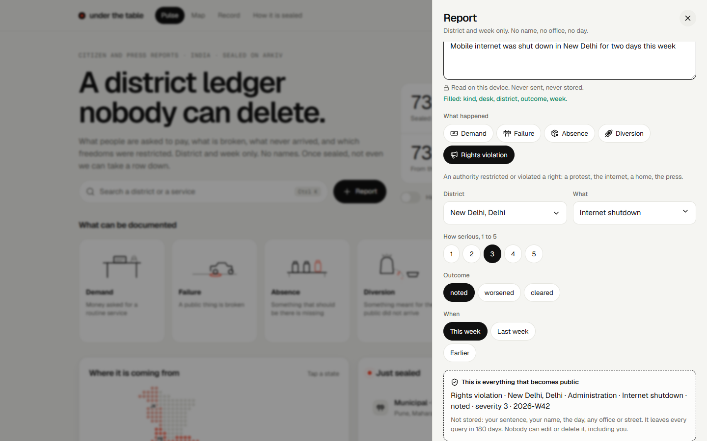

# under the table

### Bring it out from under the table.

**A district ledger of what Indians are charged, what is broken, and which rights were restricted. No names. Once a record is written, nobody can delete it, including us.**

<p align="center">
  <a href="https://underthetable.vercel.app"></a>
</p>

<p align="center">
  <a href="https://underthetable.vercel.app"><b>Open the live app</b></a> ·
  <a href="docs/submission.md">Hackathon submission</a> ·
  <a href="docs/why-arkiv.md">Why Arkiv</a> ·
  <a href="docs/what-is-recorded.md">What can be recorded</a> ·
  <a href="arkiv/schema.md">Schema</a> ·
  <a href="arkiv/friction.md">Friction report</a> ·
  <a href="docs/screenshots/README.md">Screenshots</a>
</p>

Built for the Arkiv Global Tour Stop (9 to 18 October 2026) on the Tiramisu testnet. Entered in three tracks: **Best Indian Use Case**, **Censorship Resistance** and **Open Source**. MIT licensed.

---

## Under the table

In English, a bribe is something that moves *under the table*. An envelope slides below the line of sight, nothing is written down, and afterwards there is nothing to point to.

In India the space under that table holds more than envelopes. It holds the order that switches a district's internet off, which most of the district never reads. It holds the notice that strikes a protest ground off the list, and the bulldozer that residents say arrived before the paperwork. It holds the clinic where the doctor is a name on a rota and not a person in the room, and the ration shop whose register says more grain than the sacks hold.

These have one thing in common: **they leave no record that the people affected can hold.** No receipt. No page that stays.

And when someone does write it down, the record lives somewhere that can be reached.

## "History is a set of lies agreed upon"

A line usually attributed to Napoleon, who credited it to someone else; it goes back to Fontenelle in 1724 ([Quote Investigator](https://quoteinvestigator.com/2016/07/05/fable/)). Whoever said it, notice what an *agreed* history needs: a record that can be edited, and someone to be persuaded to edit it. Whatever happens under the table survives only as long as the record of it can be kept quiet.

That is not hypothetical. **bribes.fyi**, an anonymous bribe tracker, collected 600+ reports and five million requests in its last 48 hours in August 2026, then closed on 18 August with a notice that included "the permanent deletion of any recorded data" ([ThePrint](https://theprint.in/feature/bribes-fyi-anti-corruption-site-aryan-nishad/3018441/)). The operator called it a voluntary, precautionary step. We are not saying anyone forced it. We are saying one person could make the whole record disappear, and did.

## A fortnight of it

All of this was reported in the last two weeks (every item has its sources in [press-records.md](docs/press-records.md), and is on Arkiv):

- **10 and 11 October.** Mass detentions in Delhi around protests over the voter-roll revision. Mobile internet suspended for 24 hours across central Delhi. At least **43 journalists** detained or assaulted ([CPJ](https://cpj.org/2026/10/at-least-43-journalists-detained-several-assaulted-while-covering-protests-against-indias-election-chief/)). Criticised by the UN human rights office, Human Rights Watch, Amnesty, RSF and CIVICUS. The government and police dispute much of it.
- **12 and 13 October.** The capital's main protest venue de-notified; people who entered it detained.
- **15 and 17 October.** A man declared dead after being taken from a police station in Birbhum, which his family alleges was assault. Bulldozers in Assam's Hojai and Golaghat against 211 families.
- **Every day.** Water cut for weeks in Kashmir, farmers besieging substations in Telangana, absent doctors in Uttar Pradesh, ₹3,000 taken to enter a land record in Haryana.

The numbers behind it: India recorded **65 internet shutdowns in 2025, second only to Myanmar** ([Access Now](https://www.accessnow.org/internet-shutdowns-2025/)). It scores **39/100 and ranks 91st of 182** on the Corruption Perceptions Index ([Transparency International](https://www.transparency.org/en/countries/india)). Nearly **7 in 10** businesses in a survey of 9,000 had paid a bribe in the past year ([LocalCircles via NewsMeter](https://newsmeter.in/top-stories/international-anti-corruption-day-survey-reveals-83-bribes-were-paid-in-cash-in-india-740305)).

## So we put it on the table

**under the table** is a ledger that cannot be cleared. You report in a sentence or three taps; nothing about you is stored. A district, a week, a desk and a number go on a public chain, and the record is handed to an address nobody holds. Not even we can take it down.

<p align="center"></p>

| | |
| --- | --- |
| **Demand** | ₹700 asked for a driving licence |
| **Failure** | A pothole (with an exact pin), a dead streetlight, no water, no power |
| **Absence** | A clinic with no doctor, a school with no meal |
| **Diversion** | Ration grain that arrived short |
| **Rights violation** | A detention, a journalist stopped, a home demolished, a death in custody |
| **Internet shutdown** | A district cut off from the network |

5 kinds, 13 departments, 52 services, 36 states and union territories, 338 districts. Nothing is free text. [Every kind, desk and field, and why each is an Arkiv attribute.](docs/what-is-recorded.md)

<p align="center"><br><sub><b>The Pulse.</b> What is being recorded, where, as it is sealed.</sub></p>

<p align="center"><br><sub><b>Report.</b> Say it in a sentence; it is read on your device. Everything that becomes public is shown before you file.</sub></p>

<p align="center"><br><sub><b>The map.</b> Drop a pin on a broken thing. "Search this view on Arkiv" is four range predicates the chain answers itself, printed on the page.</sub></p>

<p align="center"><br><sub><b>Rights and shutdowns.</b> "Mobile internet was shut down in New Delhi" fills the slip, on the device.</sub></p>

More: [press records](docs/screenshots/05-press-records.png) · [the Record and "Look back"](docs/screenshots/10-record.png) · [how it is sealed](docs/screenshots/11-sealed.png) · [Hindi](docs/screenshots/13-pulse-hindi.png) · [on a phone](docs/screenshots/14-pulse-mobile.png) · [the one-file mirror](docs/screenshots/16-mirror.png).

### What stays off the chain

A name, a phone number, an email, a street, a photograph, a free-text story, the exact day, the position of the person who reported. The sentence you type is read on your device and never sent; a tripwire strips phone numbers, emails, UPI handles and honorifics, in Latin and Hindi digits. A pin is allowed only for broken public infrastructure and refused for anything that could identify a person.

### How a number becomes believable without a person on chain

- A desk shows a figure only when **3 different wallets** reported it. Five slips from one wallet are one voice.
- An optional **location check**: a checker wallet vouches that the filer was inside the state, and stores only the word "inside".
- A **press curator** wallet writes labelled, sourced records from published news. They seed the board, link their articles, and **never count as a citizen**.
- **You report with your own wallet.** Your address is the creator, you pay your own gas (about 0.0002 test GLM a report), and nothing of ours is in the way. For people with no wallet there is a one-tap throwaway key, funded by a small faucet behind a human check (Cloudflare Turnstile, or a signed proof of work).
- A public chain cannot be cleaned, so **every reader refuses what is off the closed lists**: the page, the CLI, the audit and the one-file mirror apply one rule.

Honest limits, stated on the page: a wallet is a pseudonym, three wallets are not three people, a phone can fake a position, a press record is a curator's reading of an article. Citizen reports, not findings.

---

## Why Arkiv, and why a project like this cannot do without it

The product's whole promise is "nobody can take a record down, including us". That is not a feature you can add to a normal database. It is a property of **who holds the delete key**, so the choice of storage is the product. ([The long version, with every claim sourced.](docs/why-arkiv.md))

| If it were... | What breaks |
| --- | --- |
| **Postgres behind our API** | Whoever has the login can delete: us, our host, a compromised key, a court order served on us. The site *is* the record. |
| **IPFS** | Nobody can edit content-addressed data, but nobody is obliged to keep it: unpinned data is garbage-collected, and pinning "doesn't guarantee that any content is persistently available" ([IPFS docs](https://docs.ipfs.tech/concepts/persistence/)). A hash also cannot answer "this district, this week, inside this rectangle". We would be the pinner, so we are the custodian again. |
| **A subgraph** | It "indexes data from a smart contract" ([The Graph docs](https://thegraph.com/docs/en/subgraphs/quick-start/)): the records sit in a contract we deploy, and the index is a service we run and can be told to stop. |

What Arkiv gives, each with the evidence:

1. **Only the owner can delete, so we make the owner nobody.** Arkiv: "Only the owner wallet can update, extend, transfer, or delete an entity", and many operations "apply as one atomic batch" ([Fundamentals](https://docs.arkiv.network/start-here/fundamentals/)). One `executeBatch` creates a report and transfers it to `0x…dEaD`; if the transfer fails, the report is never created. `npm run audit`: 113 of 113 valid reports are owned by `0x…dEaD`. `npm run verify`: patch, delete and extend, from the author and from a stranger, all fail. The app has a "Try to delete it" button. → [`src/lib/write.ts`](src/lib/write.ts)
2. **`$creator` is set by the chain, so trust does not depend on what the writer typed.** "You can query them. You cannot set them." ([Fundamentals](https://docs.arkiv.network/start-here/fundamentals/)). Citizens, the location checker and the press curator are each recognised by address alone. A hostile writer who copies `source = press` is read as an ordinary citizen. → [`src/lib/query.ts`](src/lib/query.ts), [`test/press.test.ts`](test/press.test.ts)
3. **Tamper-evidence we can test.** State is committed with a Merkle-Patricia trie and every write is a signed transaction ([Fundamentals](https://docs.arkiv.network/start-here/fundamentals/)). A sealed row cannot change, so the ledger an hour ago must be a subset of the ledger now. The Record's **Look back** runs an `atBlock` query and checks it: 49 of 49 rows present, identical ([friction F16](arkiv/friction.md#f16-a-historical-query-at-an-earlier-block)). → [`src/views/Record.tsx`](src/views/Record.tsx)
4. **Typed, range-queryable attributes and no indexer of ours.** "No external indexer" ([Fundamentals](https://docs.arkiv.network/start-here/fundamentals/), [Querying data](https://docs.arkiv.network/typescript-sdk/querying-data/)). Amounts are `u64`; map coordinates are `i32`, and the Map tab asks the chain for everything inside a rectangle with four `gte`/`lte` predicates. It prints the query. → [`src/lib/query.ts`](src/lib/query.ts) (`fetchInBox`), [friction F17](arkiv/friction.md#f17-i32-coordinates-and-a-bounding-box-query)
5. **Records that expire on their own.** "Every entity has an expiration block. When it arrives, the entity leaves the query surface." ([Fundamentals](https://docs.arkiv.network/start-here/fundamentals/)). Every report lasts 180 days. A stale accusation about a district office is unfair and a privacy liability; here nobody schedules its removal and nobody can decide what stays.
6. **No smart contracts, by construction.** "A transaction is accepted only if its `to` address is a known Arkiv operation address… No bytecode is deployed." There is no upgrade key or admin role to hold.
7. **Ordinary Ethereum tooling.** A visitor with no wallet gets a throwaway key made in the browser and files in about 16 seconds ([friction F8](arkiv/friction.md)); a one-file page ([`public/mirror.html`](public/mirror.html)) and a `curl` command read the whole ledger with no server of ours.

**On a hostile day:** if they ask us to remove a record, we cannot. If they take down the website, the rows remain, and [`/mirror.html`](https://underthetable.vercel.app/mirror.html) or `curl` still read them. If they ask for the author, we hold nothing: no account, no name. And at 180 days the record leaves on its own.

**Honest limits:** Tiramisu is a testnet, and earlier Arkiv testnets were retired ([older networks](https://docs.arkiv.network/networks/older-networks/)), so we demonstrate the mechanism, not permanence. One sequencer produces blocks, so nobody can delete a sealed row but a sequencer could decline a new write. A public chain cannot erase abuse either, which is why every reader refuses anything off the closed lists. [All of it, with sources.](docs/why-arkiv.md#5-honest-limits-so-the-claims-above-can-be-trusted)

Every Arkiv feature we use, where it lives and how to check it: [docs/arkiv-usage.md](docs/arkiv-usage.md). Every call we made that surprised us: [arkiv/friction.md](arkiv/friction.md). The schema: [arkiv/schema.md](arkiv/schema.md).

---

## Three tracks, one idea

**Best Indian Use Case.** The problem is Indian and current: the 65 shutdowns, the Corruption Perceptions rank, a fortnight of detentions, evictions and custody deaths, all with sources. It is built for how India reports: the **district** is the unit (338 of them), Hindi and English, the desks people actually queue at (RTO, revenue, ration, health, school), a sentence parsed on the phone, no account, 390 px mobile. It is seeded with 73 sourced records from the last fortnight and says plainly that zero citizen reports exist yet.

**Censorship Resistance.** The adversary is the custodian. The record is handed to an address nobody holds, so there is no admin who can be told to empty a queue; it survives the loss of our own site (`mirror.html`, `curl`); a rival cannot pin an accusation past its life; the expiry is automatic, not editorial.

**Open Source.** MIT, public, and meant to be forked. Everything is in the repository: the closed vocabularies (`data/vocab.json`, `data/districts.json`), the press records with their sources, the lists of trusted wallets, the server routes (`server/`, bundled to `api/`), 32 tests, and the scripts that let anyone re-check every claim (`npm run audit`, `query`, `repro`). [CONTRIBUTING.md](CONTRIBUTING.md) says how to add a district, a service or a sourced record, and how to fork it for another country. The ledger itself is public and readable with `curl`. Honest limit: the animation above is a stock download and is not MIT; it is listed in [docs/assets.md](docs/assets.md) and [THIRD_PARTY_NOTICES.md](THIRD_PARTY_NOTICES.md), and the project works without it.

---

## Try it

**In the browser, in a minute: https://underthetable.vercel.app**

1. Open the **Map** tab: 11 pins, each a broken road, light, drain or garbage pile named in a news report from this fortnight (click one for its explorer link). Press **Search this view on Arkiv**.
2. Press **Report**. Type "Last week in Nashik there is a deep pothole near the bus stand", drop a pin, **Connect wallet** (any browser wallet; it adds the Tiramisu network for you; test GLM from the [faucet](https://hub.arkiv.network/faucet)), file. No wallet? Choose the one-tap key. The receipt shows `$creator` (your address), `$owner` (`0x…dEaD`) and the location check. Press **Try to delete it**.
3. Open [`/mirror.html`](https://underthetable.vercel.app/mirror.html): one file, no server of ours, reads Arkiv directly. It still works if our site does not.

**From the terminal (no website; the read-only commands need no wallet):**

```bash
git clone https://github.com/hatif03/underthetable && cd underthetable && npm ci
npm run query -- --district nashik   # the same predicates the page uses
npm run audit                         # every entity on Tiramisu against the closed lists; expect "outside the schema: 0"
npm run repro                         # friction entries F13, F5, F14, F15 against the live chain (writes nothing)
npm test                              # 35 tests: the rules, parser, PII tripwire, quote rule, pins, the human check, server wallet lanes
```

[Step-by-step for judges](docs/submission.md#g-how-can-judges-reproduce-our-arkiv-usage) · [terminal output of query, audit, verify and repro](docs/screenshots/README.md).

---

## Docs

| | |
| --- | --- |
| [submission.md](docs/submission.md) | The hackathon answers: problem, challenges, why Arkiv, wallets, reproduction, the one thing to improve |
| [why-arkiv.md](docs/why-arkiv.md) | Why a project like this needs Arkiv, every claim sourced or reproducible |
| [devfolio-form.md](docs/devfolio-form.md) | Every Devfolio field mapped to an answer, for all three tracks |
| [what-is-recorded.md](docs/what-is-recorded.md) | Everything a person can document, field by field |
| [arkiv/schema.md](arkiv/schema.md), [arkiv/friction.md](arkiv/friction.md), [arkiv/wallets.md](arkiv/wallets.md) | The data contract, 18 friction entries from real calls, every wallet and its role |
| [arkiv-usage.md](docs/arkiv-usage.md) | Arkiv feature by feature |
| [verification.md](docs/verification.md), [abuse-model.md](docs/abuse-model.md) | How a claim is checked, and what stops fakes and personal data |
| [press-records.md](docs/press-records.md) | The 73 sourced press records and their articles |
| [ai-agent.md](docs/ai-agent.md) | Is there a genuine use for an AI here? One, narrow, advisory |
| [demo-video-script.md](docs/demo-video-script.md) | What to say and how to record the 3-minute demo video |
| [CONTRIBUTING.md](CONTRIBUTING.md) | Add a district, a service or a sourced record; fork it |
| [pitch.md](docs/pitch.md), [deploy.md](docs/deploy.md), [decisions.md](docs/decisions.md), [build-plan.md](docs/build-plan.md), [assets.md](docs/assets.md) | The pitch and demo script, deploying, the decision log, the build plan, credits |

---

## Run it yourself

Node 20 or newer.

```bash
npm install
npm test            # 35 tests
npm run dev         # http://localhost:5173
npm run build:api   # rebuilds api/*.js from server/handlers (committed; Vercel runs them as they are)
npm run build       # type-checks, then builds to dist/
```

The page reads Tiramisu directly; no key is needed to read. To file with your own wallet you need nothing from us. To offer the one-tap key, the dev server needs funded keys:

```bash
cp .env.example .env     # fill DRIP_KEY (or SEED_KEY_1) and ATTEST_KEY, a funded key whose address is in data/attesters.json
```

Tiramisu testnet: chain ID `7738577`, HTTP `https://rpc.tiramisu.db-chain.testnet.arkiv.network`, WebSocket `wss://rpc.tiramisu.db-chain.testnet.arkiv.network`, explorer <https://tiramisu.explorer.arkiv.network>, gas token test GLM, faucet <https://hub.arkiv.network/faucet>. SDK `@arkiv-network/sdk` 0.8.1.

More commands:

```bash
npm run query -- --district nashik --min-inr 500
npm run query -- --created-by 0x13398a1803eCa909D909193F1547FfFc1e05eF4F
npm run verify          # patch, delete, extend on a live report and an attestation: all must fail (needs a team key)
npm run seed:press      # writes data/press-records.json to Arkiv from PRESS_KEY (add -- --dry to only check the guard)
npm run seed:pin        # writes one demo map pin (needs FLOOD_KEY)
npm run catalog         # regenerates docs/what-is-recorded.md from the vocabulary
npm run screenshots     # retakes docs/screenshots from a running dev server (reads only)
npm run e2e:wallet      # drives the page with a stand-in browser wallet and files one real report from a team test wallet (needs WALLET_TEST_KEY)
npm run ai:check        # optional: a language model re-reads cited articles against the records (needs IFM_API_KEY; advisory only)
```

### Where the keys live

- `SEED_KEY_1..3`, `FLOOD_KEY`, `DRIP_KEY` are read from `.env` by scripts, the dev server and the `api/` functions. They are never imported by `src/` and never reach the bundle.
- `ARKIV_ACCESS_KEY` is a Hub access key, server side only, sent as `X-API-KEY`. Never a `VITE_` variable. ([Access keys](https://docs.arkiv.network/start-here/access-keys/))
- `PRESS_KEY` is the press curator wallet. It writes `source = press` reports only. `ATTEST_KEY` is the checker wallet. It writes attestations only.
- `TURNSTILE_SECRET` and `HUMAN_SECRET` (optional) belong to the human check; without them a signed proof of work is used.
- **Your own wallet** signs and pays for its own reports; no key of yours ever reaches us. The one-tap option makes a throwaway key in the browser, keeps it in `localStorage`, and holds a few cents of test GLM ("New identity" drops it).
- The server can use several wallets for each job (`DRIP_KEY`, `DRIP_KEY_2`, `DRIP_KEY_3`; `ATTEST_KEY`, `ATTEST_KEY_2`): each wallet sends one transaction at a time, and a busy or empty one hands over to the next.

### Layout

```text
src/state/store.ts      one snapshot of every report, cached, live over WebSocket
src/lib/                guard (PII, pins), parse (local), write (batch), query, aggregate (quote rule), validate, identity, human
src/views/              Pulse (dot map), Map (Leaflet pins), DistrictSheet, FileSheet, Record, Sealed, Palette
src/ui/                 Radix-based kit, original animated illustrations
scripts/                seed, query, audit, verify, repro, catalog, screenshots, ai-check
server/ api/            faucet, human check, location checker, read relay (all server-side)
data/                   closed vocabularies, districts, the press records
arkiv/                  schema, friction, wallets
docs/                   submission, why Arkiv, what is recorded, screenshots, media
```

## Licence

MIT. See [LICENSE](LICENSE). Fonts: Geist (OFL). Icons: Lucide (ISC). UI primitives: Radix. State boundaries: DataMeet India (CC BY 4.0). Map tiles: © OpenStreetMap contributors. See [THIRD_PARTY_NOTICES.md](THIRD_PARTY_NOTICES.md). The animation at the top is a stock animation downloaded by the team and is **not** covered by the MIT licence; see [docs/assets.md](docs/assets.md).
