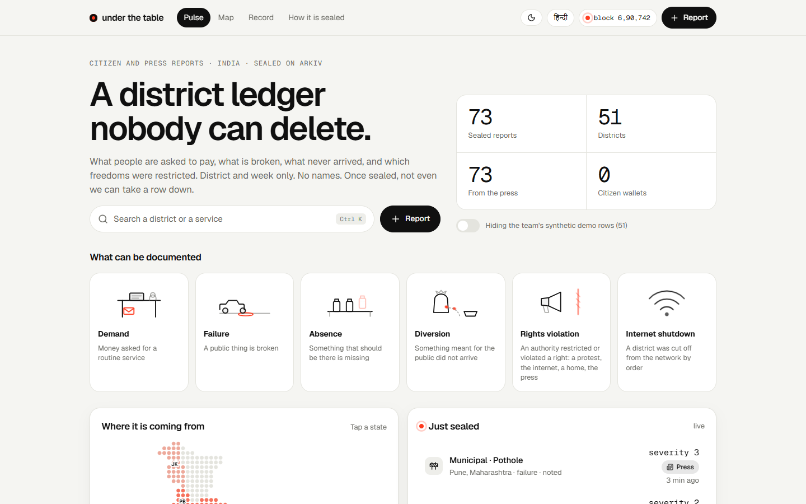
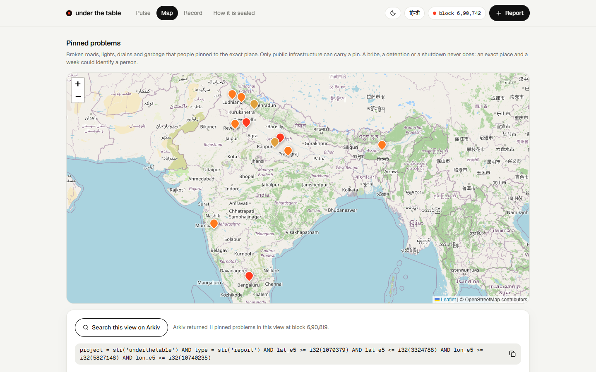

# The pitch

> **Live:** [underthetable.vercel.app](https://underthetable.vercel.app) · [mirror](https://underthetable.vercel.app/mirror.html) · [repository](https://github.com/hatif03/underthetable) · [all screenshots](screenshots/README.md)
>

*The Pulse: what can be documented, a dot map of India and the live feed.*

*The Map: pins on broken public infrastructure, and the range query the chain answers.*

Written for: the team, to rehearse and to paste into Devfolio. Every example is a real, dated, sourced report from 9 to 16 October 2026 and is in [press-records.md](press-records.md).

## One line

**A district ledger of what Indians are charged, what is broken, and what was shut down, that nobody can delete, including us.**

Shorter, for a slide: **"The record can't be taken down."**

## Thirty seconds

On 10 October, police detained more than two thousand people in Delhi, Section 163 orders covered the district, and dozens of metro stations were shut. Six days later, around 150 more were detained at a march that police had refused permission for. In Surajpur, a woman in labour found a health centre locked and her newborn died. In Barnala, a land-records official was caught taking ₹30,000 to record a land transfer.

All of it was reported. None of it is in one place that the next order, the next notice, or the next shutdown of a website cannot remove. bribes.fyi collected exactly these reports and then announced it would delete them. underthetable keeps them on Arkiv: no names, no free text, nothing personal, only the district, the desk and the week. One transaction creates a report and hands it to an address nobody holds. Not even we can take it down.

## Why this problem, and why it is everyday

Most civic records capture one rare, large event. This one captures what an ordinary person meets on an ordinary Tuesday, and what the state does on the ground in the same weeks.

| This week (sourced) | Who it touches | Kind |
| --- | --- | --- |
| Delhi, 10 Oct: more than 2,000 detained; Section 163 orders district-wide; dozens of metro stations and markets shut | Anyone near a protest, journalists, lawyers | Restriction |
| Delhi, 16 Oct: about 150 detained; a march refused permission; a park cordoned | Same | Restriction |
| Mumbai, 10 to 11 Oct: about 600, then about 300 detained | Same | Restriction |
| Surajpur, 14 to 15 Oct: a newborn died outside a locked primary health centre; two staff suspended; inquiry (the locked door is the family's account) | Any family that relies on a PHC | Absence |
| Balangir, 13 Oct: ₹3,000 taken to process a land conversion (₹6,000 first asked) | Any landowner | Bribe demand |
| Barnala, 16 Oct: ₹30,000 taken to enter a land transfer | Same | Bribe demand |
| Ghaziabad, 13 Oct: more than six lakh people without Ganga water for three days. Rampur: 20 days. Hardoi: a village without power for 15 days | Whole neighbourhoods | Failure |
| Agra and Ratlam, 16 Oct: medicines short at medical college hospitals; patients buy the rest outside | Anyone who is poor and ill | Absence |
| Kannauj, 9 Oct: a woman died after a motorcycle hit a pothole on a village road | Anyone on a bad road | Failure |

Each is a press-sourced record on Tiramisu with its articles linked. Every one maps to something an Indian can recognise. The interesting claim is not that these happen. It is that **a citizen's report next to a press report, in the same district and week, is a stronger record than either alone**, and that the record survives its custodian.

## Why Arkiv, in one breath

A table we run can be emptied by us the day we are sued or afraid. IPFS cannot answer "this district, this week, this desk, still current". A subgraph indexes events but enforces nothing. Arkiv gives, in one write: attributes you can query, a lifetime that ends on its own, a readonly flag, and an owner that nobody holds. **The product is the combination.**

Three things we do with Arkiv that the others do not:

1. **Trust by `$creator`, three ways.** The checker wallet's location marks, the press curator's `source = press`, and our own demo rows are each recognised by who wrote them, never by an attribute anyone can set. A hostile writer who copies the attribute is just read as a citizen.
2. **Two entity types linked by an entity-key attribute.** A location attestation points at its report by key. One query returns both.
3. **The reader refuses what does not belong.** A public chain cannot be cleaned, so the page, the CLI and the audit apply one validity rule and ignore anything outside the closed lists. `npm run audit` shows the whole chain against it.

## What we refuse, on purpose

No free text. No names. No photos. No Aadhaar. No moderator who can be told to empty a queue. A figure only at three wallets, shown with its spread. A press report never counts as a citizen. A location mark is called a hint. Nothing is called a finding.

## Demo script, 3 minutes

| Time | Show | Say |
| --- | --- | --- |
| 0:00 | Pulse: the dot map of India, press section | "These are real incidents from this week, each with its articles. Not citizen reports yet, so no figure, and the page says so." |
| 0:25 | Press card, Delhi, 16 Oct: open its sources | "A curator wallet wrote this from The Tribune. It is one wallet. It can never be three." |
| 0:45 | "Were you there? Report it" | "This is the cold-start fix. Someone who was there files in three taps, with no wallet and no sign-up." |
| 1:00 | Type a sentence with a phone number; it is struck out | "The sentence never leaves this device. There is no free-text field to leak into." |
| 1:15 | Location check on; allow; File | "The browser rounds my position to 5 km. A checker wallet vouches I was in the state." |
| 1:35 | Receipt: `$owner` 0x…dEaD, attestation link; "Try to delete it" | "Created and handed to an address nobody holds in one transaction. Watch me fail to delete it." |
| 1:55 | Back on Pulse: "1 citizen wallet reported the same", "Also in the press" | "The press and the citizen agree, in the same district and week. That is the verification a phone cannot give." |
| 2:15 | Terminal: `npm run audit`, `npm run query` | "Everything on Arkiv against the same rules. Nothing outside the closed lists." |
| 2:35 | `mirror.html` from disk | "Block our site. The record is still there." |
| 2:50 | Entity Expiration panel | "And it leaves on its own after 180 days." |

If a single sentence is all there is room for: **"Press can report it once. Citizens can add to it. Nobody can take it down."**

## Devfolio answers (drafts)

**Tagline.** A district ledger of what Indians are charged, what is broken, and what was shut down, that nobody can delete.

**Problem.** People in India are asked for money for routine services, live with failing water, power, roads and medicine, and meet restrictions on protest, and the record of all of it is held by someone who can be pressured to delete it. bribes.fyi collected exactly these reports and then said it would delete them. underthetable stores a closed-list, name-free report as a readonly Arkiv entity handed to an address nobody holds. Press-sourced incidents from 9 to 16 October 2026 seed the board; citizens add their own; a figure appears only at three distinct wallets.

**Why Arkiv.** Sections above. Name Postgres, IPFS, a subgraph and our own API.

**How do you use Arkiv.** [arkiv-usage.md](arkiv-usage.md), 13 rows.

**What stays off Arkiv.** Everything personal, the sentence, the day, the position, the article text. Article links live in the repository.

**Honest limits.** A wallet is a pseudonym. Three wallets are not three people. A location check is a hint. A press report is a curator's reading of an article.

**Surfaces.** TypeScript SDK, WebSocket events, raw JSON-RPC (mirror and curl), Docs, Hub, Faucet, Block Explorer.
