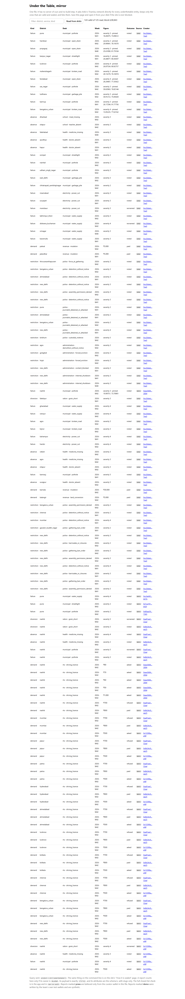
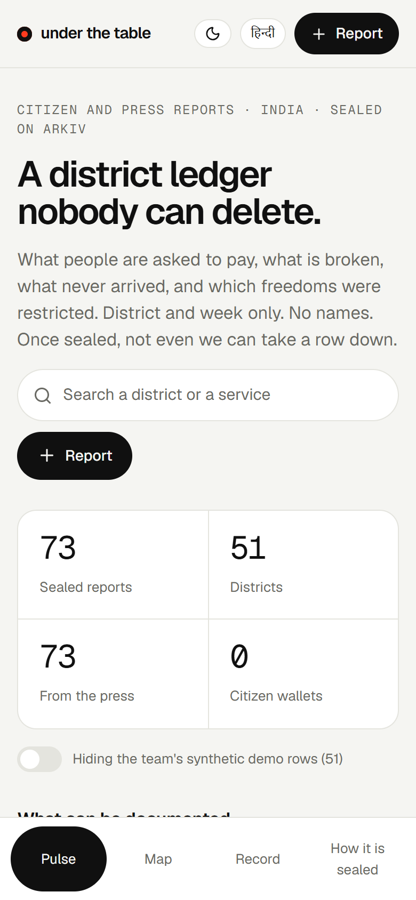

# underthetable: hackathon submission answers

Arkiv: Global Tour Stop, tracks **Best Indian Use Case**, **Censorship Resistance** and **Open Source**. Drafted 17 October 2026 for the 18 October 23:59 London deadline. Each answer below is written to be pasted into the matching Devfolio field (Markdown is supported there).

- Repository: https://github.com/hatif03/underthetable (MIT)
- Live app: https://underthetable.vercel.app
- Screenshots of every feature and the terminal output: [docs/screenshots/](screenshots/README.md)

<p align="center"><a href="https://underthetable.vercel.app"></a></p>

---

## a. The problem it solves

> "History is a set of lies agreed upon." A saying usually attributed to Napoleon, who in fact credited it to someone else and is not its author: the line goes back at least to Fontenelle in 1724 ([Quote Investigator](https://quoteinvestigator.com/2016/07/05/fable/)). Whoever said it first, the point holds: the version of events that survives is the version somebody was able to keep.

**underthetable is a district-level ledger of what Indians are asked to pay, what is broken, what never arrived, and which rights were restricted. It stores no names, and once a record is written nobody can take it down, including us.**

### What people use it for

You open it on a phone, say what happened in a sentence or three taps, and file. Nothing about you is stored: a district, a week, a desk and a number go on the public chain, and the record is handed to an address nobody holds.

| You are... | You record | What you get back |
| --- | --- | --- |
| Asked for ₹700 for a driving licence, or ₹5,000 to enter a land record | A **demand**: the desk, the role (not the person), the amount, whether you paid | A figure for that desk, once three different wallets agree |
| Living with a pothole, a dead streetlight, no water or no power | A **failure**, with an optional exact pin on the map (public infrastructure only) | A pin anyone can query: "everything inside this rectangle" |
| Seeing a clinic with no doctor, a school with no meal | An **absence** | A district count that does not depend on any department's own reporting |
| Seeing ration grain arrive short | A **diversion** | The same |
| Cut off from the network, detained at a protest, a journalist stopped, a home demolished | A **rights violation**, including an **internet shutdown** | A record that the next order cannot remove |

The full list of every kind, desk, service and field is generated from the vocabulary in [what-is-recorded.md](what-is-recorded.md): 5 kinds, 13 departments, 52 services, 36 states and union territories, 338 districts. Nothing is free text, so there is nowhere for a name to hide.

### Why India, why now

The last fortnight is the case, not an illustration of it.

- **10 and 11 October 2026.** Delhi saw mass detentions around the protests over the election authority's voter-roll revision. Human Rights Watch says police "wrongfully detained thousands of people" and "arbitrarily detained at least 30 journalists"; the Committee to Protect Journalists counts **at least 43 journalists** detained or assaulted across cities; Reporters Without Borders calls it an "unprecedented police crackdown on the press". Mobile internet was suspended for 24 hours across central Delhi, in a 4 km radius.
- **A shutdown that was challenged in court.** The Supreme Court said on 11 October that internet should function unhindered, and the Union Home Secretary has defended the suspension as proportionate.
- **A venue removed.** On 12 October police de-notified Delhi's main protest site, and on 13 October people who entered it were detained.
- **Prohibitory orders.** Delhi Police imposed Section 163 BNSS orders in New Delhi district on 2 October, barring gatherings of five or more without written permission, and a Section 163 order was in force for the 20 July march too.
- **Evictions and demolitions.** On 17 October, eviction drives began in Assam's Hojai (152 families) and Golaghat (59 families), with bulldozers; in Agra, residents say homes were demolished without notice.
- **Deaths in custody.** In West Bengal's Birbhum on 15 October, a man was declared dead after being taken from a police station; the family alleges assault.
- **And the everyday.** Water cut for weeks in Kashmir, farmers besieging substations in Telangana, absent doctors in Uttar Pradesh, an anti-corruption trap over ₹3,000 in Haryana's Palwal. 73 of these are already on Arkiv, each with its published sources ([press-records.md](press-records.md)).

**Why a ledger that cannot be deleted.**

1. **The people who record this are the ones who lose their records.** bribes.fyi, an anonymous bribe tracker built by a 20-year-old student, went viral in August 2026 (more than 600 reports, over five million requests and 200,000 new users in its last 48 hours) and then closed on 18 August with a notice that included "the permanent deletion of any recorded data". It called the step voluntary and precautionary. That is exactly the problem: the operator of a table is the single point that fear, a notice, or a bill can reach. 
2. **A record does change things.** I Paid a Bribe fed an ombudsman whose April 2016 passport report recommended dropping the police verification of addresses, which often involves bribes ([Ideas for India, June 2016](https://www.ideasforindia.in/topics/governance/i-paid-a-bribe-using-technology-to-fight-corruption-in-india)).
3. **The scale is not small.** Transparency International scores India 39/100 and ranks it 91st of 182 on the 2025 Corruption Perceptions Index. In a LocalCircles survey of more than 9,000 businesses in 159 districts, nearly 7 in 10 had paid a bribe in the previous twelve months. Access Now counted **65 internet shutdowns in India in 2025, second only to Myanmar (95)**; SFLC.in counted 32 in 2026 up to 10 October, with Delhi highest at 8.
4. **The world has noticed, and said so.** Human Rights Watch, Amnesty International, the UN human rights office, RSF, CPJ and CIVICUS have each criticised how India is policing dissent and the press in 2026. The UN rights office urged on 10 October that anyone "arbitrarily detained" be released and that restrictions on peaceful protest "meet strict tests of necessity and proportionality"; India's foreign ministry called those concerns "unwarranted and at the same time unacceptable". Amnesty (24 August) documented pellet-firing shotguns, tear gas and electric-shock devices against the July protests and said no officer in Delhi had been held accountable. RSF ranks India **157th of 180** on the 2026 press freedom index; Freedom House rates it 62/100, "Partly Free"; CIVICUS rates civic space "repressed" and added India to its global Watchlist in July. UN experts in February warned of "systemic" policing failures over deaths and torture in custody.
   - Fairness: the government and police dispute much of this. Delhi Police called its handling "professional"; election authorities say the roll changes remove "duplicate, deceased, and fraudulent entries"; detention totals differ widely by source (Reuters about 2,000, The Hindu about 2,500, CIVICUS at least 7,000). We do not adjudicate; we attribute.

**The sentence that explains the product:** if the only record of a week is the one held by the party the record is about, then history is whatever that party agrees to keep. underthetable puts a second copy, written by the people who were there and by the press, somewhere that party cannot reach, and it makes the copy cheap to check: anyone can query it, and nobody can edit it.

### Why it is safe to use

Documenting abuses by authorities is risky for the person documenting. So the design refuses to hold anything that could identify them:

- **No free text, no names, no photos, no phone numbers.** The sentence box is parsed on the device and never sent; a tripwire strips digits (Latin and Hindi), UPI handles, spelled-out emails and honorifics before anything is filled in.
- **A district and a week, never a day.** An exact day plus a district plus a service can single out a reporter, so the day is not stored.
- **Pins only for public infrastructure.** A pothole may carry a pin; a bribe, a detention or a shutdown never can, because an exact place and a week could identify a person.
- **No account.** The browser makes a throwaway key and a server pays its first gas, after a human check that is not an identity check.
- **No moderator.** Nobody exists who can be told to empty a queue.
- **Limits, stated on the page:** a wallet is a pseudonym, three wallets are not three people, a phone can fake a position, a press report is a curator's reading of an article, and everything is a citizen report, not a finding.

---

## b. Challenges I ran into

1. **A public chain cannot be cleaned.** Anyone can write anything to Arkiv, including a name. I could not rely on a moderator, so the reader is the defence: one validity rule ([validate.ts](../src/lib/validate.ts)) applied by the page, the CLI, the one-file mirror and `npm run audit`. A report counts only if it is exactly the schema, on the closed lists, has the `{"v":1}` payload, and is owned by the dead address. Hostile-input tests cover a name in a slug, an extra attribute, a payload note, a future week, a u64 where an i32 belongs. Getting this right turned a product problem ("how do we stop abuse?") into a read-side filter that costs nothing on chain.
2. **The anonymous read budget (HTTP 429, `ANON_COST_LIMITED`).** Within minutes of building I was refused on reads, including right after a successful write (friction F2, F3, F11). The first answer was a server snapshot read once and shared by everyone, a browser cache, a "read directly" switch, and a one-file mirror. The real answer was an access key, which I tested: 120 reads in a row, all 200 ([F18](../arkiv/friction.md)). The key lives only on the server, is sent as `X-API-KEY`, and is never a `VITE_` variable.
3. **A bare number silently matches nothing.** `gte("amount_inr", 500)` returned 0 rows with no error; `u64(500n)` returned 38. A bare JavaScript number is `i32`, and an `i32` predicate on a `u64` attribute matches nothing (F13). I found it by getting an empty board that I knew was not empty, wrote `npm run repro` to demonstrate it, and then used `i32` deliberately for map coordinates (F17).
4. **`$createdAt` cannot be filtered, and creation events carry no attributes.** AGENTS.md said to range-filter on `$createdAt`; the node said it carries no index (F5). A live feed from `watchEntityEvents` would have meant reading every entity on a busy shared chain (77 creates in 90 seconds), spending the whole budget in two minutes (F6). I filter events by `creationFlags` and lifetime (readonly, not extendable, 180 days) before any read, then call `getEntity` at most once every five seconds.
5. **No personal data, even by accident.** A free-text box is a leak waiting to happen. I removed free text entirely, parsed the sentence on the device, and then broke my own tripwire: Hindi digits slipped through until I normalised the Indic digit blocks (`(cp & 0xf) - 6` for the `…66` to `…6F` ranges). The test now checks Hindi digits, UPI handles, spelled emails and separated digit runs.
6. **Seeding honestly.** An empty ledger proves nothing, and fabricating citizens would be dishonest. So the board is seeded with **press-sourced** records written by a clearly labelled curator wallet, which can never count as a citizen voice, with the articles linked. For the latest batch I did not trust my own research: two independent fact-checking agents re-opened every source. They found problems in eleven of the 36 records: an "about 250 detained" figure that is in none of the cited articles, four severities that were overstated, a statement from a police commissioner that no cited article contains, a claim about a district's power cuts that the article makes only for "several rural areas", and "evicted" where the source says the drive "began". I applied every correction and dropped one record entirely because every available source URL contains the victim's full name, which would have put a name into the repository.
7. **A bug a screenshot caught.** After adding map pins, the one-file mirror reported "112 valid of 114" while `npm run audit` said 113: the mirror's allowed-attribute list did not know `lat_e5` and `lon_e5`, so it silently rejected the pin. I only noticed because I was taking screenshots. The mirror now applies the same pin rules.
8. **Proving a person without identifying one.** The faucet could be drained by a script minting wallets. A CAPTCHA identifies no one but needs a third party and keys; so the human check is Cloudflare Turnstile when configured, and otherwise a 16-bit proof of work signed by the server. I first set 18 bits, measured 4.4 seconds in pure JavaScript SHA-256 on a desktop, and lowered it to 16 because a phone would be several times slower. The interface says plainly that this prices a flood and does not prove a unique human.
9. **Exact location without surveillance.** "Share live location" is the opposite of the privacy promise unless it is scoped. I made the pin the place of the *problem*, not the person: allowed only for public infrastructure, refused for everything else, validated both when written and when read (India bounds, and within one dot of the report's own state), and the picker tells people to move the pin off their own street.
10. **Smaller ones.** A nested-button bug in the press badge; a backdrop-filter that broke the fixed header on phones; district names that changed (Aurangabad became Chhatrapati Sambhajinagar, Didwana-Kuchaman is a new district) and had to be added before a record could pass the guard; a Section 163 claim that I could verify for 2 October and 20 July only, and not for 10 to 11 October, so I did not claim it.

---

## c. Why Arkiv?

> The long form, with every claim tagged official / ours / limit and linked to Arkiv's documentation, is [why-arkiv.md](why-arkiv.md).

**Short version: the product's central promise is "nobody can take a record down, including us". That is a property of who holds the delete key, and only one of the four alternatives takes the key away from the operator.**

### What would break with each alternative

| If it were... | What breaks | Evidence you can check |
| --- | --- | --- |
| **Postgres, behind our own API** | We hold the `DELETE`. The product's only promise becomes "trust us". The exact failure already happened to the category: bribes.fyi closed on 18 August 2026 with "permanent deletion of any recorded data". A table can also be edited, which makes a count unprovable. | Sealed page links the ThePrint story. Arkiv: `npm run verify` makes four writes against a live report and all four revert on the owner check. |
| **IPFS** | A content hash cannot answer "this district, this week, this desk, severity at least 3, inside this map rectangle". It also has no expiry (a record that is 180 days old is a stale accusation that should leave on its own) and no creator. Pinning decides what survives, and we would be the pinner. | `npm run query -- --district nashik --min-inr 500` and the map's "Search this view on Arkiv". |
| **A subgraph** | It indexes events from a chain that holds the data somewhere else. It enforces nothing: not a lifetime, not a readonly flag, not an owner that can no longer delete. We would run the indexer, and it is a server that can be told to stop. | The record needs no indexer of ours: the mirror and `curl` read the node directly. |
| **Our own API on any database** | The same as Postgres. Plus it is one more place a notice can reach. | Block our site: [mirror.html](../public/mirror.html) still reads every row. |

### The advantages that exist only because it is Arkiv

Each is something Arkiv enforces or answers itself, with a command that proves it:

1. **Create and seal in one transaction.** `predictEntityKeys` + `executeBatch` with `ownershipChanges` creates the entity and transfers it to `0x…dEaD` atomically. If the transfer cannot be included, the whole batch reverts, so a deletable report never exists. **Check:** 113 of 113 valid reports on chain are owned by `0x…dEaD` (`npm run audit`: "outside the schema: 0"); `npm run verify`: `patchEntity`, `deleteEntity` and `extendEntity` from the creator and `extendEntity` from a stranger all fail.
2. **`$creator` is set by the chain, so trust does not depend on what the writer typed.** The checker's location attestations, the press curator's `source = press`, and the team's demo rows are recognised by address alone, from three short lists in the repo. A hostile writer who copies `source = press` is read as an ordinary citizen. A Postgres column filled in by the writer cannot give this.
3. **Range queries on typed attributes, answered by the chain's index.** `amount_inr` is `u64`; `lat_e5` and `lon_e5` are `i32`. The map's "Search this view on Arkiv" is four range predicates and returned 1 pin in a box around Nashik and 0 around Bengaluru ([F17](../arkiv/friction.md)), with the query printed on the page. Postgres could do this too, but it would be our table; here no server of ours is on the path.
4. **Entity Expiration.** Every report leaves queries 180 days after it was written, with no cron job and no delete button. A one-hour demo row has already expired; the explorer still shows its creation.
5. **`atBlock` historical queries make "never edited" testable.** Because a sealed entity cannot change, the board an hour ago must be a subset of the board now. The Record page's "Look back" runs the query at an earlier block and checks it: 49 of 49 rows from an hour earlier were present with the same attributes ([F16](../arkiv/friction.md)). A table we run cannot offer that proof.
6. **Two entity types, one query, linked by an entity-key attribute.** Reports and their location attestations arrive in one read (`project = str('underthetable')`), and an attestation points at its report by `key(...)`, not a copy ([F9](../arkiv/friction.md)). Verification cost zero extra queries against a budget of about 100 an hour.
7. **`readonly: true` and `permissionlessExtension: false`.** An amount cannot be edited and a rival cannot pin an accusation past its 180 days.
8. **A neutral read surface.** Raw JSON-RPC (`arkiv_query`, `arkiv_getEntityCount`, `$owner = addr(...)`), an optional access key, a WebSocket event stream, an explorer. The one-file mirror, the CLI and the audit all use it, which is why the product keeps working when our site does not. `$owner = addr(0x…dEaD)` returned 113, equal to the number that exist (F12).

**The combination is the product.** Any single property can be approximated elsewhere; none of the alternatives gives all of them in one write with no server of ours in the path.

More: [arkiv-usage.md](arkiv-usage.md), 13 features each with where it lives and how to check it without the website.

---

## d. Friction report

https://github.com/hatif03/underthetable/blob/main/arkiv/friction.md

18 entries (F1 to F18), each from a call that was actually made, with what I expected, what happened, versions (`@arkiv-network/sdk` 0.8.1, `viem` 2.57.7, Node v24.20.0, Tiramisu, 16 to 17 October 2026) and steps. A path that worked is recorded the same way (F8, F9, F12, F16, F17, F18). Entries that other teams' public friction files also report say so (F13, F14, F15). `npm run repro` re-runs the main ones against the live chain and writes nothing; its output is in [screenshots/terminal-repro.txt](screenshots/terminal-repro.txt).

---

## e. Wallet addresses that create Arkiv entities

All on Tiramisu (chain 7738577). Private keys are in a git-ignored `.env` and never leave the team's machines.

| Address | Role | Creates |
| --- | --- | --- |
| `0xC26DEbe828cd500c6d31F184BaeCce2782847eA3` | **Press curator** (`PRESS_KEY`). Writes `source = press` reports from published news, closed lists, no names. Trusted by address from `data/curators.json`. | 73 reports |
| `0xabd68359A33fAb9A03Bb706B56272370A011E5b6` | **Location checker** (`ATTEST_KEY`). Writes `attestation` entities only: "this wallet was inside this state when it filed". Trusted from `data/attesters.json`. Runs server-side. | attestations |
| `0x13398a1803eCa909D909193F1547FfFc1e05eF4F` | Demo creator 1 (`SEED_KEY_1`). Synthetic rows. Also funded the other wallets. | demo reports |
| `0x8b34C95Cda664550C4eb9C4Ba14BB7172D6Ada25` | Demo creator 2 (`SEED_KEY_2`). Synthetic rows. | demo reports |
| `0xa81eef553318368e1c98F851c29521Ab247532aD` | Demo creator 3 (`SEED_KEY_3`). Synthetic rows. | demo reports |
| `0xeE368405802Ca49d38572f88dE24b9ba044F2804` | Flood demo (`FLOOD_KEY`): five slips in one bucket to show five slips are one voice. Also wrote the single demo map pin (a pothole in Nashik). | demo reports, 1 pin |
| `0xc3A64559E2Bee5E542EF3180934646A89c3dB67B`, `0x7ca1817218D26f2c6FAc7e63fE2D97307c1fb92F`, `0x80AA599b39308191f323E4bf1C212f4F241d7365` | Throwaway browser identities used while testing the filing flow end to end (3 Pune reports, 1 attestation). Treated as demo rows. | test reports |
| `0x0812fed1e90C8d2bff9C3EdB0D3D46CbEf5FA303` | **Faucet** (`DRIP_KEY`). Pays 0.02 test GLM to a visitor's new key after a human check. | none |
| *(many, not listed)* | **Visitors' browser identities.** Each report filed from the page is signed by a throwaway key generated in that browser and funded through `/api/drip`. They cannot be listed in advance. The page counts each as one citizen wallet. | citizen reports |

Demo and test wallets are hidden by default on the page ("Hiding the team's synthetic demo rows") and never counted as citizens. Details with transaction hashes: [arkiv/wallets.md](../arkiv/wallets.md).

---

## f. Schema

https://github.com/hatif03/underthetable/blob/main/arkiv/schema.md

Two entity types, `report` and `attestation`, with every attribute, type, query operator, validity rule and the exact write batch. New on 17 October: the `administration` department and four rights-violation services (internet shutdown, content blocked, demolition without notice, forced eviction), plus the optional `lat_e5` / `lon_e5` `i32` attributes for map pins.

---

## g. How judges can reproduce our Arkiv usage

You need Node 20 or later. No key is required for the read-only steps; they work on the public RPC (about 100 reads an hour), and faster with a Hub access key as `ARKIV_ACCESS_KEY`.

**1. Open the live app** at https://underthetable.vercel.app. The Pulse tab shows 73 press-sourced records (toggle the demo rows to see the 51 synthetic ones). Open the **Map** tab (11 pins, each named in a news report) and press **Search this view on Arkiv**: the page prints the exact range query it sent and what Tiramisu returned.

**2. Read the chain without our site.**

```bash
git clone https://github.com/hatif03/underthetable && cd underthetable
npm ci
npm run query -- --district nashik        # the same predicates the page uses
npm run audit                              # every underthetable entity against the closed lists; expect "outside the schema: 0"
npm run verify                             # four writes against a live report; all four must revert on the owner check
npm run repro                              # friction F13, F5, F14, F15 against the live chain (writes nothing)
```

`audit` and `query` read; `verify` signs writes with a wallet from `.env` and so only runs for the team (its recorded output is in [docs/screenshots/terminal-verify.txt](screenshots/terminal-verify.txt)). The rest need no wallet.

**3. Do it with `curl` (no code of ours at all).**

```bash
curl -s https://rpc.tiramisu.db-chain.testnet.arkiv.network -H 'content-type: application/json' \
  -d '{"jsonrpc":"2.0","id":1,"method":"arkiv_getEntityCount","params":[{"query":"project = str('"'"'underthetable'"'"') AND $owner = addr(0x000000000000000000000000000000000000dEaD)"}]}'
```

The Sealed page lists the others. `$owner = addr(0x…dEaD)` returns the number of sealed entities; it equals the number of entities our audit reads.

**4. Look at one entity on the explorer.** https://tiramisu.explorer.arkiv.network/entity/0x311025deec017feb6f5242bcc6aa5fd09781ab22f9d99d190bc0c906aac08ab8 (the demo pin) or any press report in [press-records.md](press-records.md). Check **Owner**: `0x…dEaD`.

**5. Block our site.** Open [public/mirror.html](../public/mirror.html) from disk: one file, no build, it reads Arkiv directly and applies the same validity rule.

**6. File a report yourself (writes to Tiramisu).** In the live app press **Report**, say "Last week in Nashik there is a deep pothole near the bus stand", drop a pin, file. The receipt shows `$creator` (your throwaway wallet), `$owner` (`0x…dEaD`), the human check, the location check and an attestation link. Press **Try to delete it** and watch it fail. Your report will then appear in `npm run audit`.

**7. Tests.** `npm test` runs 32 tests, including the hostile-input cases for names, off-list slugs, pins in the wrong place, and proof-of-work replay.

---

## h. The one thing Arkiv should improve first

**Make read limits legible and survivable before anything else: a documented, discoverable access-key path, and an error that says so.**

Every serious builder hits the anonymous budget within the first hour, and today the failure is an HTTP 429 whose body is not JSON (`"ANON_COST_LIMITED"`), with no wait time and no pointer to the fix. We hit it on a plain read (F2), on the read straight after our own successful write (F3), and straight after a 26-entity seed (F11). An access key removes the problem completely (120 consecutive reads, all 200, F18) but it is not mentioned where the 429 appears, and a pasted key is a leaked key, which a quickstart should say.

Concretely: (1) return a JSON-RPC error that names the limit, the remaining budget and `Retry-After`, and says "get an access key at hub.arkiv.network"; (2) put the key in the quickstart's first query, with the server-side-only warning; (3) count `predictEntityKeys` and receipt reads separately from `arkiv_query`. Everything else on our friction list is a papercut by comparison; this is the one that makes a judge's first visit to a working app look like a broken one.

*If forced to pick a second:* reject or coerce a type-mismatched comparison (F13), because several teams independently hit the same silent zero-row result.

---

## Screens

| | |
| --- | --- |
|  |  |
| The Pulse: what can be documented, and 73 sourced records | The Map tab: an Arkiv range query for "pins inside this rectangle" |
|  |  |
| A pothole with an exact pin; public summary shown before filing | A rights violation read from a sentence, on the device |
|  |  |
| The one-file mirror reads Arkiv with no server of ours | A 390 px phone |

All sixteen screenshots and four terminal outputs: [screenshots/README.md](screenshots/README.md).
