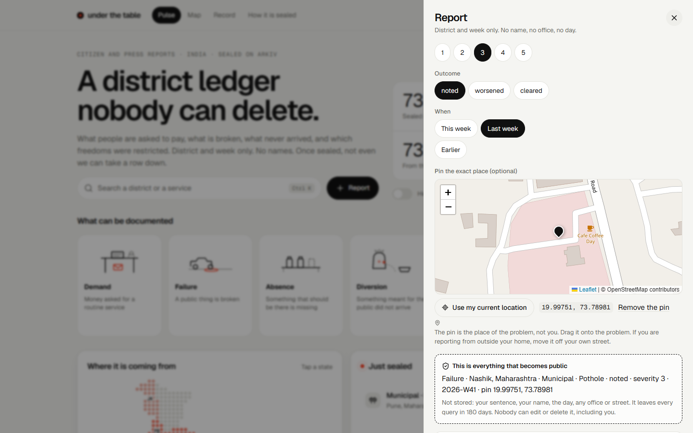

# Verifying a claim without putting a person on Arkiv

> **Live:** [underthetable.vercel.app](https://underthetable.vercel.app) · [mirror](https://underthetable.vercel.app/mirror.html) · [repository](https://github.com/hatif03/underthetable) · [all screenshots](screenshots/README.md)
>


*The form shows exactly what becomes public before anything is filed. A location check is optional and stores only the word "inside".*

Written 16 October 2026. The question: a report is a claim, and anyone can write one. Can the website check a claim itself, using location or something else, when nothing personal may go on Arkiv?

Short answer: partly, and only by being honest about what each check proves. One check is built (a location check by state). The others are listed with why they were not built.

## What a check can and cannot prove

A report says: "in this district, this week, this desk asked for this." Nothing a phone or a browser can report proves that sentence. What a check can do is raise the cost of lying and shrink who can lie:

| Threat | What helps |
| --- | --- |
| A troll far away files about a district they have never visited | A location check at filing time |
| One person files as many wallets and fakes a 3-wallet figure | Anything that ties a wallet to one real person (identity, phone, Aadhaar proof). A location check helps only a little. |
| A real person exaggerates or lies | Nothing technical. The quote rule, the median and the 180 days limit the damage. |
| An official or a custodian suppresses a true report | Arkiv: sealed, readonly, dead owner |

The two things that matter most for a bribe or conduct index are "were you really there" and "are you one person". The first is partly solvable now. The second is not, without collecting identity, which is the one thing this product must not do.

## What was built: a location check by state

1. The person turns on "Check my location" in the report form (on by default). The browser asks for permission once.
2. The browser rounds the position to 0.05 degrees (about 5 km) on the device, and compares it with the state on the report using the half-degree dot grid. If it is clearly a different state, the form says so and does not file. The person can turn the check off and file anyway.
3. After the report is sealed, the filing wallet signs `underthetable: location check for <report key>`. The browser sends the key, the signature and the rounded position to `/api/attest`.
4. The server (`server/attest.ts`) reads the report from Arkiv, checks that it is an underthetable report, that it was created in the last 30 minutes, that the signature is from the report's `$creator`, and that the position is inside the report's state (DataMeet state polygons, with one rounding step of margin). It checks that no attestation exists yet.
5. If all of that holds, the **checker wallet** writes a second Arkiv entity of type `attestation`: `report` (an entity-key reference), `method = geo`, `scope = state`, `state`. It is readonly, `permissionlessExtension` is false, and it is handed to `0x…dEaD` in the same batch. The position is not written anywhere.
6. Readers load reports and attestations in one query, and trust an attestation only if its `$creator` is listed in `data/attesters.json`. A report with a trusted attestation for its own state shows a check mark. A desk with 3 checked wallets is **corroborated**. The 3-wallet quote rule is unchanged.

### Why this fits Arkiv

- The trust anchor is `$creator`, which cannot be forged. The checker is one wallet; its address is public; anyone can read every attestation and see who wrote it. The checker can add a mark. It cannot remove or alter a report, and it cannot remove its own marks after the batch.
- A reference by entity key (`key(...)` attribute) links the two entities without copying data. A query `type = attestation AND report = key(<report>)` finds a report's check.
- The attestation expires with the same 180 days, so a mark never outlives what it vouches for by more than the time between the two writes.
- Nothing about the person is on chain: not the position, not the time of day beyond the block, not the IP.

### What the checker server sees, and what that costs

The server sees the rounded position (about 5 km), the signature, and the network address of the request, as any server does. The code does not store or log them. Vercel and any proxy in front may log the network address; that is outside this code. This is a real trust assumption and the form says so. Zero-trust is not possible here: a check done only in the browser is a claim the browser makes about itself.

### What it does not prove

- A phone can fake a position (developer tools, a mock-location app, a VPN for the network address). A determined person defeats this.
- State level is coarse. It does not prove someone was in Nashik, only in Maharashtra. District level needs district boundaries under a licence that allows redistribution. The district file found (GADM, 594 districts, boundaries before Telangana was split off) is not licensed for redistribution as far as I read its terms, so it was downloaded, looked at and deleted. This is the next step, not a claim.
- The position is when the report was filed, not when the incident happened.
- Demo rows from the four team wallets are never checked, and the page says so.

## What was considered and not built

| Option | What it would add | Why not now |
| --- | --- | --- |
| **Anon Aadhaar** (zero-knowledge proof of a valid Aadhaar, from the PSE team) | Proves "an Indian resident, one per nullifier" without revealing who. The only option here that attacks the one-person-many-wallets problem. | Proof generation in the browser downloads large circuit files and has to be integrated and tested. It also sits close to the line the rules draw on personal data, so it needs a careful read of the proof's public outputs first. Strong candidate for the next version. |
| Phone number one-time code | One wallet per phone | The checker would learn a phone number. A blind-signature scheme avoids that and is a project of its own. |
| DigiLocker or any government login | Strong identity | Needs an official partner registration. It also links a person to a report, which is the harm to avoid. |
| IP geolocation only | No permission prompt | Coarse, fooled by a VPN, and gives the same exposure as the location check with less accuracy. |
| Photo of a receipt or notice | Evidence | A photo is personal data and cannot go on Arkiv. Hashing it does not change that under the rules. |
| Two-step "I saw this too" confirmations | Corroboration by others | That is what filing the same desk already does. |
| Waiting period before a figure shows | Slows a coordinated flood | Cheap to add later as a rule on `$createdAt`; not needed at demo scale. |

## How to check it yourself

```bash
npm run query     # prints "location-checked N" and, per quoted desk, how many wallets were checked
npm run verify    # confirms an attestation is owned by 0x…dEaD and cannot be deleted by a stranger
```

On the page: file with the location check on, open the receipt, follow the "attestation" link to the explorer, then look for the check mark on the report in the feed and the Record.

## What to say in the Devfolio form

The check is a second entity type, written by a checker wallet, trusted by `$creator`, linked by an entity-key attribute, sealed like a report. It improves the "How you use Arkiv" answer and the "Why this pillar" answer (a report can be checked without a person being on chain). It must be described as a hint against remote trolls, with its limits, not as proof.

## Anon Aadhaar: what it needs, from its own documentation

Read on 16 October 2026 from the project's documentation and repository. Anything marked "not stated" was not in those pages and has to be checked before building.

- **No API key and no hosted service of the project's.** Proof generation runs in the browser or a mobile app, so the Aadhaar details do not go to a server. The packages are `@anon-aadhaar/core` (generate and verify), `@anon-aadhaar/react` (login component), `@anon-aadhaar/circuits` and `@anon-aadhaar/contracts`. MIT licence.
- **External things it does depend on.** The circuit artifacts (wasm, zkey, verification key) are fetched from an AWS-hosted bucket by default. They can be self-hosted from the `public` folder. Their size and the time to prove are not stated in the docs. The UIDAI public key is fetched from UIDAI's site and is checked on verification.
- **What the person has to bring.** The signed secure QR code of an Aadhaar document (the e-Aadhaar or a print letter), from which the browser extracts the signed data and signature. Getting that document from UIDAI needs the person's own Aadhaar-linked mobile number. This is real friction and it excludes people who do not have the document at hand.
- **What the proof reveals.** Nothing from the card by default. Optional reveals are over-18, gender, state and PIN code. It outputs a nullifier and a signal.
- **The nullifier.** `nullifier = Hash(nullifierSeed, photo)`. It is the same for the same person under the same seed, which is how one person is held to one proof. It is a hash derived from personal data (the photo). **Under this challenge's rules it must not be written to Arkiv**, plaintext or hashed. It would have to live off Arkiv, on a server of ours, which makes us a custodian of a table that can single out one person across reports. That is a real cost and the decision belongs to the team.
- **Verification.** Off-chain with `init()` then `verify()` from `@anon-aadhaar/core`, checking the UIDAI key hash, that the proof is under an hour old, and the nullifier seed. There is also a Solidity verifier for on-chain use.
- **Status.** The repository says new features are developed internally and outside contributions are mainly fixes. An audits folder exists; its results were not read.

### How it would fit here, if the team chooses to build it

1. The person proves "a valid Aadhaar holder, in <state>" in the browser, with the state revealed only if they choose.
2. Our server checks the proof, checks the nullifier has not been used under our seed, stores only the nullifier on our side, and has the checker wallet write an attestation with `method = zk_aadhaar` and **no nullifier on it**.
3. A desk could then show "3 wallets, each backed by a distinct Indian resident". That is the strongest answer to one person making many wallets.

What it costs: a custodian table of nullifiers, a heavy first load, a document most people have to fetch first, and the risk that the wrong choice here puts personal data on a public chain. It is feasible. It is not a thing to ship in the last two days without a test on a real device.
